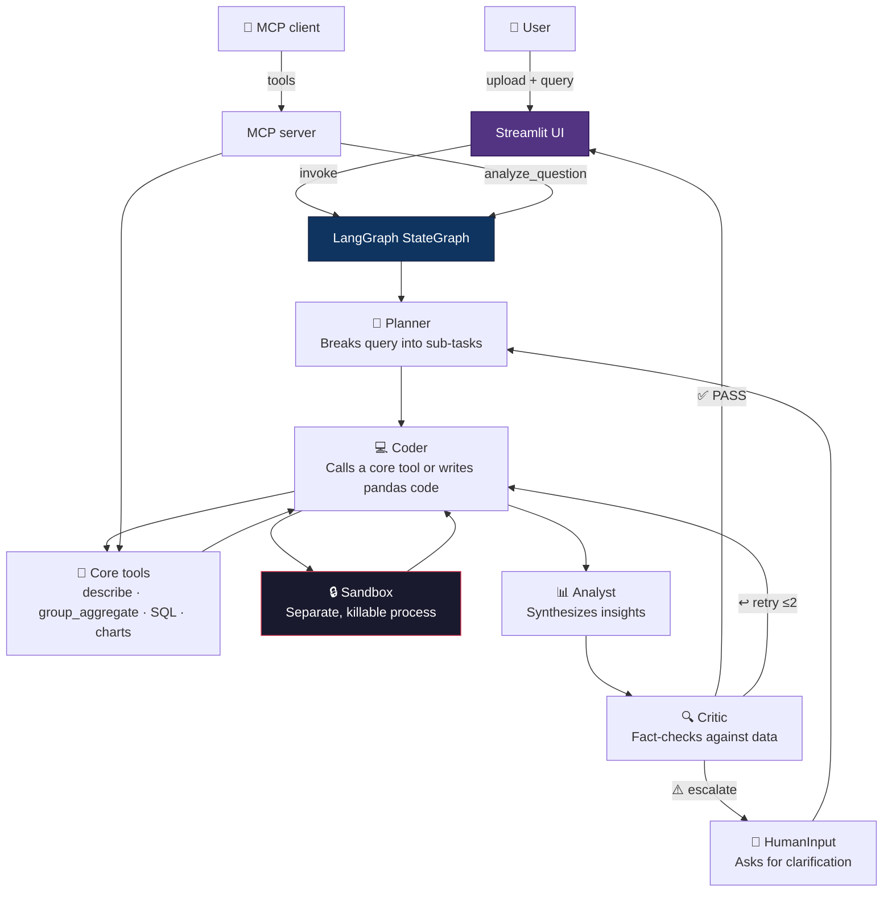

# 🤖 Multi-Agent Data Analyst

**🔗 Live App:** [multi-agent-data-analyst.streamlit.app](https://multi-agent-data-analyst-qyzldehynt3vfjoyjumvev.streamlit.app/) · [](https://github.com/thakursamir0000-star/multi-agent-data-analyst/actions/workflows/ci.yml)

An autonomous, multi-agent data analysis system powered by **LangGraph**, **Groq**, and **Streamlit**. Upload any CSV/Excel dataset, ask questions in plain English, and watch specialized AI agents plan, compute, analyze, and verify insights — all with full observability.

The same tools are also available to any AI assistant through an **[MCP server](#mcp-server)** (Claude Desktop, IDEs, other agents): exact deterministic analysis, read-only SQL, charts, sandboxed pandas, and the whole multi-agent pipeline as one tool.

---

## Architecture



### Agent Roles

| Agent | Role | Temperature |
|-------|------|-------------|
| **Planner** | Breaks queries into concrete, pandas-executable sub-tasks | 0.2 |
| **Coder** | Generates Python code and executes in sandbox | 0.1 |
| **Analyst** | Turns code outputs into plain-English, data-backed insights | 0.3 |
| **Critic** | Cross-checks every numerical claim against actual outputs | 0.1 |
| **HumanInput** | Pauses graph for human clarification when needed | N/A |

### State Flow

```
user_query → Planner → sub_tasks → Coder (loop) → code_outputs 
→ Analyst → draft_insight → Critic → verified_insight → User
```

---

## Setup

### Prerequisites
- Python 3.11+
- A [Groq API key](https://console.groq.com/)

### Installation

```bash
# Clone the repository
git clone https://github.com/thakursamir0000-star/multi-agent-data-analyst.git
cd multi-agent-data-analyst

# Create virtual environment
python -m venv venv
venv\Scripts\activate      # Windows
# source venv/bin/activate  # macOS/Linux

# Install dependencies
pip install -r requirements.txt

# Configure environment
cp .env.example .env
# Edit .env and add your GROQ_API_KEY
```

### Generate Sample Data

```bash
python sample_data/generate.py
```

### Run the App

```bash
streamlit run app/main.py
```

Open your browser to `http://localhost:8501`.

---

## Usage

1. **Upload** a CSV or Excel file using the file uploader.
2. **Ask** a question in the chat input (e.g., "What are the top 5 products by revenue?").
3. **Watch** the agents work in the sidebar trace panel.
4. **Respond** if the system asks for clarification (human-in-the-loop).
5. **Review** the verified insight and any generated plots.

---

## Example Queries

Try these with the bundled `sample_data/sales_sample.csv`:

### 1. Basic Aggregation
> **"What are the top 5 products by revenue?"**

The Planner creates sub-tasks to group by product, sum revenue, sort, and display top 5. The Coder generates pandas code, and the Analyst writes a narrative citing actual revenue figures.

### 2. Correlation + Visualization
> **"Is there a correlation between discount and profit margin? Show a scatter plot."**

The system calculates a correlation coefficient and generates a scatter plot with trend line. The Critic verifies the correlation value matches the code output.

### 3. Multi-Step Analysis
> **"Summarize monthly trends and flag any anomalies."**

The Planner breaks this into: parse dates → group by month → calculate metrics → detect anomalies (z-score) → generate trend chart. The Analyst writes a narrative covering seasonal patterns and outliers.

---

## Project Structure

```
multi-agent-data-analyst/
├── agents/                    # LangGraph nodes
│   ├── state.py               # Shared TypedDict state schema
│   ├── planner.py             # Query → sub-tasks
│   ├── coder.py               # Sub-task → pandas code → execution
│   ├── analyst.py             # Code outputs → narrative insight
│   ├── critic.py              # Fact-checking & routing
│   ├── human_input.py         # Human-in-the-loop pause
│   └── graph.py               # StateGraph wiring & routing
├── core/                      # Deterministic analysis layer (see above)
│   ├── datasets.py            # Dataset registry (controlled entry point)
│   ├── analysis.py            # describe, group_aggregate, correlate, anomalies
│   ├── charts.py              # make_chart
│   ├── sql.py                 # Read-only DuckDB queries
│   ├── tools.py               # run_tool: operations by name on a dataset ID
│   ├── schemas.py             # Pydantic argument/result models
│   └── errors.py              # CoreError hierarchy
├── mcp_server/                # MCP server (python -m mcp_server)
│   ├── server.py              # create_server + CLI (stdio / Streamable HTTP)
│   ├── tools.py               # Tool adapters over core/, sandbox and graph
│   ├── resources.py           # dataset://…/schema, trace://… resources
│   ├── prompts.py             # Reusable analysis prompts
│   └── context.py             # Config, per-client scopes, sessions
├── tools/                     # Utilities
│   ├── data_tool.py           # CSV/Excel loader + profiler
│   ├── sandbox.py             # Restricted code executor (AST scan + process isolation)
│   ├── sandbox_worker.py      # Child process that runs one snippet
│   └── observability.py       # Trace logger decorator
├── app/
│   └── main.py                # Streamlit frontend
├── evaluation/
│   └── benchmark.py           # End-to-end benchmark with pandas ground truth
├── .github/workflows/ci.yml   # Lint, tests, benchmark
├── tests/                     # Unit & integration tests
├── sample_data/               # Demo dataset + generator
├── logs/                      # JSONL trace logs (auto-generated)
├── requirements.txt
├── .env.example
└── README.md
```

---

## Security

Generated code passes through layered defenses:

1. **AST pre-scan** (before anything runs): blocks dangerous calls (`open`, `exec`, `eval`, `compile`, `__import__`), dunder and frame introspection, and file/network access through allowed libraries (`pd.read_*`, `df.to_csv("path")`, `np.load`, `plt.savefig`, `pandas.io`, …), including aliased references.
2. **Import whitelist**: only `pandas`, `numpy`, `matplotlib`, `math`, `statistics`, `datetime`, `json`, `re`, `io`, `base64`, `collections`, `itertools`, `functools`.
3. **Restricted builtins**: a curated safe set only.
4. **Process isolation**: each snippet runs in a fresh child Python process (`tools/sandbox_worker.py`):
   - killed on timeout (`SANDBOX_TIMEOUT_SECONDS`, measured after start-up), so a runaway loop can't keep running inside the app;
   - memory and CPU limits on Linux/macOS (`SANDBOX_MAX_MEMORY_MB`, default 2048);
   - an empty temp working directory and **no secrets in its environment** (API keys aren't passed on);
   - its own copy of the data, so a snippet that edits `df` (adds, drops or overwrites columns) can't change the session's dataset for later questions;
   - results come back as JSON only, never pickle, so a compromised child can't run code in the app.
5. **Deterministic core tools first**: common questions are answered by tested functions, not generated code (see below).

`SANDBOX_ISOLATION=thread` runs snippets in-process instead (faster for local development, weaker isolation). For hostile multi-tenant use, run the app or MCP server itself in a container as well.

---

## Deterministic Core Layer

`core/` holds deterministic data-analysis operations that the agents call instead of generating code for common questions. The LLM chooses an operation; tested code computes the exact result:

```
Common question   → Coder picks a core tool → core function → exact, structured result
Unusual question  → Coder writes pandas code → sandbox (run_pandas fallback)
```

This cuts down how much of the numerical work depends on generated Python. The layer has no LLM or MCP code, so the LangGraph app now and an MCP server later can both use it.

**Dataset registry** (`core/datasets.py`). The only way data enters the core layer. `DatasetRegistry` accepts uploads (the Streamlit app registers every upload), in-memory DataFrames, and bare file names from one approved directory. Every dataset gets a stable ID (`ds_` + 16 hex characters, derived from its name and content), and every other call refers to it by that ID. An ID is never treated as a path, and file names are only opened after the registry checks that they resolve to a regular file directly inside the approved directory. Inputs such as `../../secret.txt` or `C:\Users\...` are rejected. The registry exposes metadata, the column schema, the profile and a *copy* of the DataFrame.

**Deterministic tools** (`core/analysis.py`, `core/charts.py`, `core/sql.py`), all reachable by name through `core.tools.run_tool(registry, dataset_id, tool, arguments)`:

| Tool | What it does |
|------|--------------|
| `describe` | count, nulls, mean, std, min, quartiles, max for numeric columns |
| `group_aggregate` | `count` / `sum` / `mean` / `median` / `min` / `max` of a column per group |
| `correlate` | pairwise Pearson or Spearman correlations |
| `detect_anomalies` | IQR outliers (default, k = 1.5) or z-score outliers |
| `make_chart` | bar / line / scatter / histogram as a base64 PNG plus the plotted values |
| `query_sql` | one read-only DuckDB `SELECT` over the registered datasets |

Arguments are validated by strict Pydantic models, where unknown keys and wrong types are rejected. Results are Pydantic models that serialize to JSON. Tools always work on the dataset exactly as uploaded, never on changes that sandbox code made to `df`.

**DuckDB SQL** (`core/sql.py`). A query must be exactly one statement (counted by DuckDB's own parser, so comments, strings and whitespace cannot hide a second one). Its statement type must be `SELECT`, and it must start with `SELECT`, `WITH`, `FROM`, `VALUES` or `(`. This rejects `INSERT`, `UPDATE`, `DELETE`, `DROP`, `ALTER`, `CREATE`, `ATTACH`, `COPY`, `PRAGMA`, `SET` and similar statements. File, network and nested-query functions (`read_csv`, `glob`, `query`, …) are refused before execution. Each query then runs in a fresh in-memory database with:
- external access disabled and no temp directory;
- Python variable lookup off and the configuration locked;
- only the registered datasets visible as tables;
- a row cap and a timeout.

**`run_pandas` fallback.** When no tool fits (derived columns, date parsing, reshaping, custom plots), the Coder writes pandas code that runs in the existing sandbox, unchanged. Tool errors go through the Coder's normal self-correction, so the LLM can retry with a fixed tool call or switch to code. Set `ENABLE_CORE_TOOLS=false` to go back to the code-only Coder.

**Security boundaries.** The registry decides which data exists, and nothing in `core/` opens a path supplied by a caller. SQL can only read registered tables. The sandbox keeps its own AST scan, import whitelist and timeout for generated code.

**Registry scope.** A registry is the unit of data visibility: every tool on it, including `query_sql` joins, can read everything registered in it. The Streamlit app keeps one registry per browser session, and the MCP server keeps one per client session (below).

---

## MCP Server

`mcp_server/` exposes the analyst to any [Model Context Protocol](https://modelcontextprotocol.io) client.

```bash
python -m mcp_server                             # stdio: the client starts one process per user
python -m mcp_server --http --port 8000          # Streamable HTTP at http://127.0.0.1:8000/mcp
```

**Claude Desktop** (`claude_desktop_config.json`):

```json
{
  "mcpServers": {
    "data-analyst": {
      "command": "/path/to/multi-agent-data-analyst/venv/bin/python",
      "args": ["-m", "mcp_server"],
      "env": {
        "PYTHONPATH": "/path/to/multi-agent-data-analyst",
        "GROQ_API_KEY": "gsk_..."
      }
    }
  }
}
```

| Kind | Name | What it does |
|---|---|---|
| Tools | `open_session`, `register_dataset`, `list_datasets`, `get_dataset_schema`, `get_dataset_profile` | Sessions and data (upload CSV/Excel, or a file from the approved data folder) |
| Tools | `describe`, `group_aggregate`, `correlate`, `detect_anomalies`, `query_sql`, `make_chart` | Exact, deterministic analysis; charts return a PNG plus the plotted values |
| Tools | `run_pandas` | Sandboxed pandas when no tool fits (permission-gated) |
| Tools | `analyze_question` | The whole multi-agent pipeline on one question (permission-gated; uses the server's Groq key) |
| Resources | `dataset://{id}/schema`, `trace://{run_id}` | Column schema; the step-by-step trace of an `analyze_question` run |
| Prompts | `analyze_dataset`, `data_quality_report` | Ready-made instructions for the client's model |

**Isolation and permissions.**
- **stdio:** one process serves exactly one client, so the process owns one local scope; `run_pandas` and `analyze_question` are on by default.
- **Streamable HTTP:** MCP requests carry no client identity, so a client calls `open_session` and passes the returned unguessable token on every call; each token has its own datasets and traces, and unknown or idle sessions are refused. Code execution is **off** by default (`AGENTAI_MCP_ALLOW_RUN_PANDAS=true` / `AGENTAI_MCP_ALLOW_ANALYZE_QUESTION=true` to enable), server files aren't exposed unless `AGENTAI_DATA_DIR` is set, and uploads are capped.
- **Remote SQL policy:** over HTTP, `query_sql` also refuses functions that describe the server instead of the data — `current_setting()`, `duckdb_settings()`, `version()`, every `duckdb_*()` / `pragma_*()` function, the session user and the clock (its offset reveals the server's time zone). Local use keeps the standard policy.

The tests in `tests/test_mcp_server.py` drive every tool through the server exactly as a client's requests would, including session isolation between two HTTP clients.

---

## Observability

Every node transition is logged to:
- **In-state `trace_log`**: Consumed by the Streamlit trace panel for real-time display.
- **Disk JSONL files**: `logs/trace_{thread_id}.jsonl` for post-hoc analysis.

Each log entry contains:
```json
{
  "timestamp": "2024-01-15T10:30:45.123Z",
  "node_name": "Coder",
  "input_summary": "query=top 5 products, task_idx=0",
  "output_summary": "updated_keys=[code_outputs, current_task_index]",
  "tokens_used": 1834,
  "input_tokens": 1512,
  "output_tokens": 322,
  "latency_ms": 1234.56,
  "error": null
}
```

---

## Evaluation

`evaluation/benchmark.py` runs the full graph on 15 questions about `sample_data/sales_sample.csv` — totals, filters, rankings, a correlation, a month-level trend, a profit margin, missing values and a top-3 — whose answers are computed directly in pandas. An answer counts as correct when the final insight states the expected number (normal rounding, `%`, `K`/`M` allowed) or every expected name.

| Metric | Meaning |
|---|---|
| Accuracy | Final insight contains the right answer |
| Verified by critic / verified but wrong | How often the Critic passed the answer, and how often it passed a wrong one |
| Clarification requests | Questions that ended in human-in-the-loop instead of an answer |
| Mean retries | Critic → Coder retries per question |
| Core-tool share | Steps answered by deterministic tools instead of generated pandas |
| Latency p50 / p95, tokens / question | Cost of an answer |

```bash
python evaluation/benchmark.py --dry-run                     # questions + ground truth, no LLM
python evaluation/benchmark.py                               # full run, needs GROQ_API_KEY
python evaluation/benchmark.py --model openai/gpt-oss-20b    # benchmark another model
```

A full run uses a large share of Groq's free daily token allowance for one model, so CI doesn't spend it on every push: start it from **Actions → CI → Run workflow** (pick the model there), or let the weekly scheduled run do it; the table appears in the run summary. Per-minute rate limits are waited out, a daily limit stops the run early with a note, and errors are reported separately from accuracy — a run in which nothing could be scored fails instead of reporting 0%.

**Results:** *added after the first CI run.*

---

## Testing

```bash
pip install -r requirements-dev.txt
ruff check .
python -m pytest tests/
```

The suite needs no API key (LLM calls are mocked). It covers the agents and graph routing, the core tools and SQL policies, the sandbox's static checks and its process isolation (timeouts, data copies, no secrets in the child, results that can't be spoofed), the MCP server end to end, and the benchmark's scoring. CI runs lint and tests with the sandbox in process-isolation mode.

---

## Configuration

| Environment Variable | Default | Description |
|---------------------|---------|-------------|
| `GROQ_API_KEY` | (required) | Your Groq API key |
| `GROQ_MODEL` | `openai/gpt-oss-120b` | Groq model to use |
| `MAX_RETRIES` | `2` | Max Critic → Coder retries |
| `SANDBOX_TIMEOUT_SECONDS` | `30` | Code execution timeout |
| `SANDBOX_ISOLATION` | `process` | `process` (separate, killable child) or `thread` (in-process, for development) |
| `SANDBOX_MAX_MEMORY_MB` | `2048` | Memory limit for sandboxed code (Linux/macOS) |
| `MAX_UPLOAD_MB` | `50` | Maximum file upload size |
| `ENABLE_CORE_TOOLS` | `true` | Let the Coder use deterministic core tools (`false` = code only) |
| `AGENTAI_DATA_DIR` | `sample_data/` on stdio, none on HTTP | Folder the MCP server may register files from |
| `AGENTAI_MCP_ALLOW_RUN_PANDAS` | on (stdio) / off (HTTP) | Expose `run_pandas` over MCP |
| `AGENTAI_MCP_ALLOW_ANALYZE_QUESTION` | on (stdio) / off (HTTP) | Expose `analyze_question` over MCP |
| `AGENTAI_MCP_MAX_UPLOAD_MB` | `20` (stdio) / `5` (HTTP) | MCP upload limit |

---

## License

MIT
