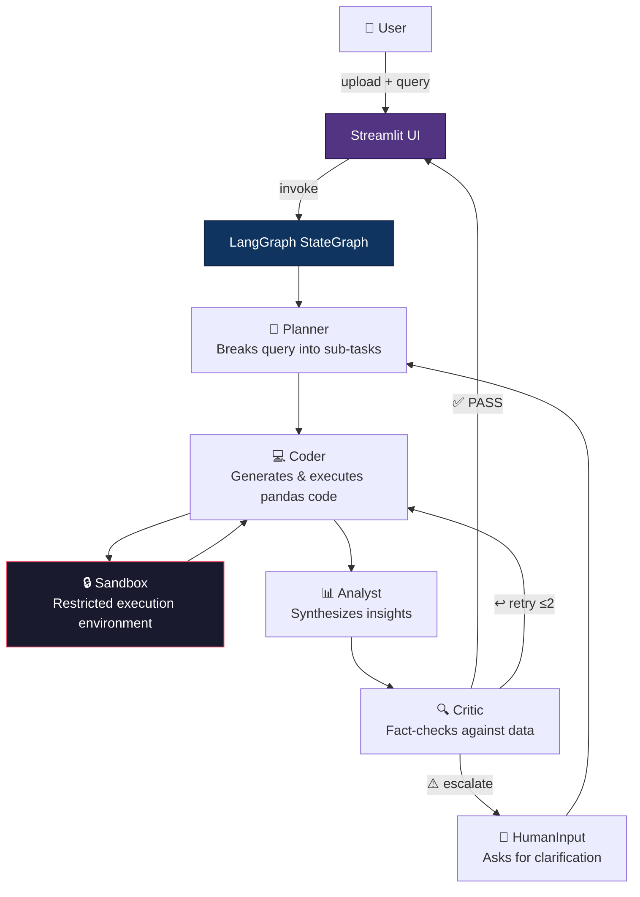

# 🤖 Multi-Agent Data Analyst

**🔗 Live App:** [multi-agent-data-analyst.streamlit.app](https://multi-agent-data-analyst-qyzldehynt3vfjoyjumvev.streamlit.app/)

An autonomous, multi-agent data analysis system powered by **LangGraph**, **Groq**, and **Streamlit**. Upload any CSV/Excel dataset, ask questions in plain English, and watch specialized AI agents plan, code, analyze, and verify insights — all with full observability.

---

## Architecture



### Agent Roles

| Agent | Role | Temperature |
|-------|------|-------------|
| **Planner** | Breaks queries into concrete, pandas-executable sub-tasks | 0.2 |
| **Coder** | Generates Python code and executes in sandbox | 0.1 |
| **Analyst** | Turns code outputs into plain-English, data-backed insights | 0.3 |
| **Critic** | Cross-checks every numerical claim against actual outputs | 0.1 |
| **HumanInput** | Pauses graph for human clarification when needed | N/A |

### State Flow

```
user_query → Planner → sub_tasks → Coder (loop) → code_outputs 
→ Analyst → draft_insight → Critic → verified_insight → User
```

---

## Setup

### Prerequisites
- Python 3.11+
- A [Groq API key](https://console.groq.com/)

### Installation

```bash
# Clone the repository
git clone <repo-url>
cd Agentai

# Create virtual environment
python -m venv venv
venv\Scripts\activate      # Windows
# source venv/bin/activate  # macOS/Linux

# Install dependencies
pip install -r requirements.txt

# Configure environment
cp .env.example .env
# Edit .env and add your GROQ_API_KEY
```

### Generate Sample Data

```bash
python sample_data/generate.py
```

### Run the App

```bash
streamlit run app/main.py
```

Open your browser to `http://localhost:8501`.

---

## Usage

1. **Upload** a CSV or Excel file using the file uploader.
2. **Ask** a question in the chat input (e.g., "What are the top 5 products by revenue?").
3. **Watch** the agents work in the sidebar trace panel.
4. **Respond** if the system asks for clarification (human-in-the-loop).
5. **Review** the verified insight and any generated plots.

---

## Example Queries

Try these with the bundled `sample_data/sales_sample.csv`:

### 1. Basic Aggregation
> **"What are the top 5 products by revenue?"**

The Planner creates sub-tasks to group by product, sum revenue, sort, and display top 5. The Coder generates pandas code, and the Analyst writes a narrative citing actual revenue figures.

### 2. Correlation + Visualization
> **"Is there a correlation between discount and profit margin? Show a scatter plot."**

The system calculates a correlation coefficient and generates a scatter plot with trend line. The Critic verifies the correlation value matches the code output.

### 3. Multi-Step Analysis
> **"Summarize monthly trends and flag any anomalies."**

The Planner breaks this into: parse dates → group by month → calculate metrics → detect anomalies (z-score) → generate trend chart. The Analyst writes a narrative covering seasonal patterns and outliers.

---

## Project Structure

```
Agentai/
├── agents/                    # LangGraph nodes
│   ├── state.py               # Shared TypedDict state schema
│   ├── planner.py             # Query → sub-tasks
│   ├── coder.py               # Sub-task → pandas code → execution
│   ├── analyst.py             # Code outputs → narrative insight
│   ├── critic.py              # Fact-checking & routing
│   ├── human_input.py         # Human-in-the-loop pause
│   └── graph.py               # StateGraph wiring & routing
├── core/                      # Deterministic analysis layer (see above)
│   ├── datasets.py            # Dataset registry (controlled entry point)
│   ├── analysis.py            # describe, group_aggregate, correlate, anomalies
│   ├── charts.py              # make_chart
│   ├── sql.py                 # Read-only DuckDB queries
│   ├── tools.py               # run_tool: operations by name on a dataset ID
│   ├── schemas.py             # Pydantic argument/result models
│   └── errors.py              # CoreError hierarchy
├── tools/                     # Utilities
│   ├── data_tool.py           # CSV/Excel loader + profiler
│   ├── sandbox.py             # Restricted code executor
│   └── observability.py       # Trace logger decorator
├── app/
│   └── main.py                # Streamlit frontend
├── tests/                     # Unit & integration tests
├── sample_data/               # Demo dataset + generator
├── logs/                      # JSONL trace logs (auto-generated)
├── requirements.txt
├── .env.example
└── README.md
```

---

## Security

The sandbox executor enforces three security layers:

1. **AST Pre-Scan**: Parses code and blocks dangerous function calls (`open`, `exec`, `eval`, `compile`, `__import__`) before execution.
2. **Import Whitelist**: Only allows `pandas`, `numpy`, `matplotlib`, `math`, `statistics`, `datetime`, `json`, `re`, `io`, `base64`, `collections`, `itertools`, `functools`.
3. **Execution Timeout**: 30-second limit (configurable via `SANDBOX_TIMEOUT_SECONDS`).

> **Note**: While these layers provide defense-in-depth, this is NOT a production-grade sandbox. For production use, consider containerized execution (Docker) or a dedicated sandboxing service.

---

## Deterministic Core Layer

`core/` holds deterministic data-analysis operations that the agents call instead of generating code for common questions. The LLM chooses an operation; tested code computes the exact result:

```
Common question   → Coder picks a core tool → core function → exact, structured result
Unusual question  → Coder writes pandas code → sandbox (run_pandas fallback)
```

This cuts down how much of the numerical work depends on generated Python. The layer has no LLM or MCP code, so the LangGraph app now and an MCP server later can both use it.

**Dataset registry** (`core/datasets.py`). The only way data enters the core layer. `DatasetRegistry` accepts uploads (the Streamlit app registers every upload), in-memory DataFrames, and bare file names from one approved directory. Every dataset gets a stable ID (`ds_` + 16 hex characters, derived from its name and content), and every other call refers to it by that ID. An ID is never treated as a path, and file names are only opened after the registry checks that they resolve to a regular file directly inside the approved directory. Inputs such as `../../secret.txt` or `C:\Users\...` are rejected. The registry exposes metadata, the column schema, the profile and a *copy* of the DataFrame.

**Deterministic tools** (`core/analysis.py`, `core/charts.py`, `core/sql.py`), all reachable by name through `core.tools.run_tool(registry, dataset_id, tool, arguments)`:

| Tool | What it does |
|------|--------------|
| `describe` | count, nulls, mean, std, min, quartiles, max for numeric columns |
| `group_aggregate` | `count` / `sum` / `mean` / `median` / `min` / `max` of a column per group |
| `correlate` | pairwise Pearson or Spearman correlations |
| `detect_anomalies` | IQR outliers (default, k = 1.5) or z-score outliers |
| `make_chart` | bar / line / scatter / histogram as a base64 PNG plus the plotted values |
| `query_sql` | one read-only DuckDB `SELECT` over the registered datasets |

Arguments are validated by strict Pydantic models, where unknown keys and wrong types are rejected. Results are Pydantic models that serialize to JSON. Tools always work on the dataset exactly as uploaded, never on changes that sandbox code made to `df`.

**DuckDB SQL** (`core/sql.py`). A query must be exactly one statement (counted by DuckDB's own parser, so comments, strings and whitespace cannot hide a second one). Its statement type must be `SELECT`, and it must start with `SELECT`, `WITH`, `FROM`, `VALUES` or `(`. This rejects `INSERT`, `UPDATE`, `DELETE`, `DROP`, `ALTER`, `CREATE`, `ATTACH`, `COPY`, `PRAGMA`, `SET` and similar statements. File, network and nested-query functions (`read_csv`, `glob`, `query`, …) are refused before execution. Each query then runs in a fresh in-memory database with:
- external access disabled and no temp directory;
- Python variable lookup off and the configuration locked;
- only the registered datasets visible as tables;
- a row cap and a timeout.

**`run_pandas` fallback.** When no tool fits (derived columns, date parsing, reshaping, custom plots), the Coder writes pandas code that runs in the existing sandbox, unchanged. Tool errors go through the Coder's normal self-correction, so the LLM can retry with a fixed tool call or switch to code. Set `ENABLE_CORE_TOOLS=false` to go back to the code-only Coder.

**Security boundaries.** The registry decides which data exists, and nothing in `core/` opens a path supplied by a caller. SQL can only read registered tables. The sandbox keeps its own AST scan, import whitelist and timeout for generated code.

**Requirements for a future remote (MCP) server.** The current policies are sized for the local app, where the person querying also runs the server:
- **Registry scope.** A registry is the unit of data visibility: every tool on it, including `query_sql` joins, can read everything registered in it. The Streamlit app keeps one registry per browser session. An MCP server must scope registries per client/session too, and must never share one global registry between unrelated clients.
- **SQL introspection.** Remote SQL must also block information disclosure through `current_setting()`, `duckdb_settings()`, `version()`/`pragma_platform()` and similar environment/path introspection functions. These are harmless locally but reveal server paths and versions remotely. The preferred approach is an allowlist of analytical functions (see the notes in `core/sql.py`).

---

## Observability

Every node transition is logged to:
- **In-state `trace_log`**: Consumed by the Streamlit trace panel for real-time display.
- **Disk JSONL files**: `logs/trace_{thread_id}.jsonl` for post-hoc analysis.

Each log entry contains:
```json
{
  "timestamp": "2024-01-15T10:30:45.123Z",
  "node_name": "Coder",
  "input_summary": "query=top 5 products, task_idx=0",
  "output_summary": "updated_keys=[code_outputs, current_task_index]",
  "tokens_used": 0,
  "latency_ms": 1234.56,
  "error": null
}
```

---

## Testing

```bash
# Run all tests
python -m pytest tests/ -v

# Run specific test files
python -m pytest tests/test_sandbox.py -v    # Security tests
python -m pytest tests/test_data_tool.py -v  # Data loading tests
python -m pytest tests/test_graph.py -v      # Integration tests
```

---

## Configuration

| Environment Variable | Default | Description |
|---------------------|---------|-------------|
| `GROQ_API_KEY` | (required) | Your Groq API key |
| `GROQ_MODEL` | `openai/gpt-oss-120b` | Groq model to use |
| `MAX_RETRIES` | `2` | Max Critic → Coder retries |
| `SANDBOX_TIMEOUT_SECONDS` | `30` | Code execution timeout |
| `MAX_UPLOAD_MB` | `50` | Maximum file upload size |
| `ENABLE_CORE_TOOLS` | `true` | Let the Coder use deterministic core tools (`false` = code only) |

---

## License

MIT
